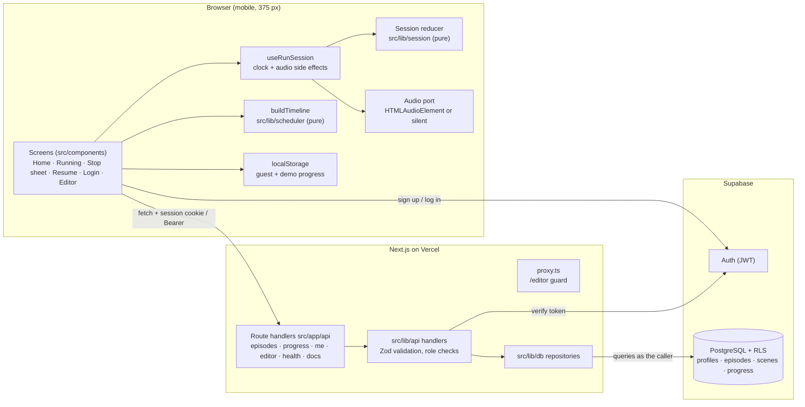

# RunX architecture

Status: implemented (Sprint 1 and 2). Update this file in the same PR that changes the structure. Rules for AI tools are in `AGENTS.md`; the reasons behind big choices are in `docs/decisions/`.

## Overview
A Next.js web app that plays a pre-generated audio story scheduled to fit the runner's chosen length. Logic lives in plain TypeScript modules under `src/lib/` (no framework, no browser APIs where possible); pages and API routes are thin wrappers. Supabase stores accounts, episodes and progress.

## Modules
| Path | Responsibility | Depends on |
|---|---|---|
| `src/lib/scheduler/` | `buildTimeline(manifest, durationMin, checkpoint)`: pure, deterministic, no clock or DOM | manifest types only |
| `src/lib/session/` | Run state machine: loading, playing, paused, stop choice, sign-off, compressed ending, complete | scheduler, injected clock and audio |
| `src/lib/progress/` | Valid checkpoints, save and resume; adapters for the database (signed in) and localStorage (guest) | db adapter |
| `src/lib/db/` | Supabase repositories (episodes, progress, editor drafts) and the browser client | Supabase SDK |
| `src/lib/api/` | Route handler logic with injected dependencies; one error shape | db, manifest, progress |
| `src/lib/audio/` | Audio port (HTML or silent) and clip preloading | none |
| `src/lib/manifest/` | Zod schema, validator, labels | none |
| `src/lib/run/` | Durations, run options, clock format | none |
| `src/content/` | Episode manifest and audio file references (validated with Zod) | none |
| `src/components/` | Presentational UI following `DESIGN.md` | session state via props |
| `src/app/` | Pages and `api/` route handlers: validate input, call `src/lib`, return JSON | `src/lib` |
| `supabase/migrations/` | Schema as SQL; the only way the database changes | none |

## Data model (issue #2)
`profiles` (user id, role: runner or editor) · `episodes` · `scenes` (type, duration, audio file, prerequisites, checkpoint) · `progress` (user, episode, last checkpoint, status in progress or complete). Row-level security: a user reads and writes only their own `progress`; only editors write `episodes` and `scenes`.

## Key flows
- **New run:** pick length, `buildTimeline` returns a timeline, the player loads the clips, then the session plays scene by scene against the session clock.
- **Stop:** the session finishes the current line, then offers Save for next time, Finish the story now or Keep running. Save plays a sign-off and stores the last completed checkpoint; Finish plays a compressed ending and marks the episode complete only after it has fully played.
- **Resume:** the saved checkpoint is passed back into `buildTimeline`; if the remaining required story does not fit the chosen length, the result says so and the UI offers a longer option.
- **Guest:** same flow in accelerated time with progress in localStorage; offered for import on first login.

## Testing and delivery
Unit tests cover `src/lib` (scheduler at 90% or more), integration tests cover route handlers and queries, Playwright runs one full flow from `e2e/` with an accelerated clock. GitHub Actions runs lint, tests and build on every pull request; Vercel builds a preview per pull request and deploys `main` to production. Details: `docs/features/FR-08_quality_ci.md` and `FR-09_deploy_documentation.md`.

## Known open points
- Whether audio keeps playing with the screen locked on iOS Safari: device tests pending, see `docs/spikes/lock-screen-audio.md`.
