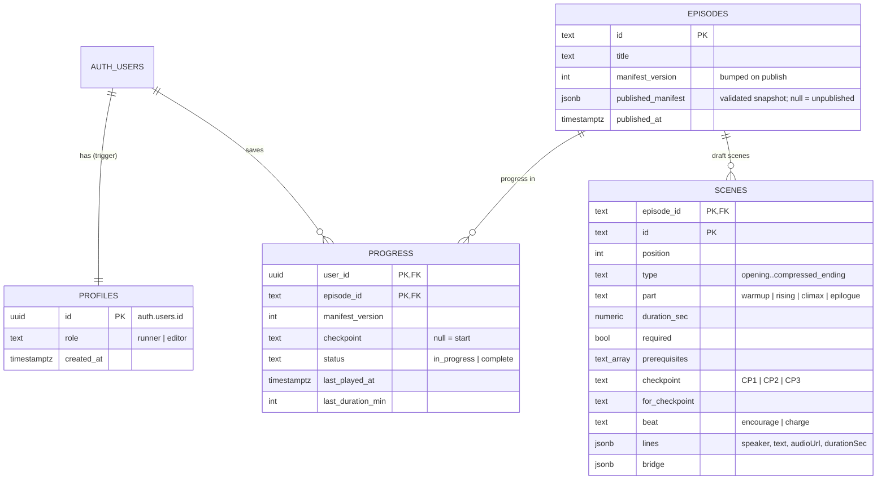

# Database schema

Source: `supabase/migrations/20261101000000_initial_schema.sql`. Seed: `supabase/seed.sql` (generated by `node scripts/content/generate-seed.mjs`).

## Row-level security
| Table | anon | runner | editor |
|---|---|---|---|
| `profiles` | none | read own row | read own row |
| `episodes` | read published | read published | read and write all |
| `scenes` (drafts) | none | none | read and write |
| `progress` | none | read and write own rows only | read and write own rows only |

Roles are never set by the client: `profiles` has no insert or update policy. Grant the editor role with SQL in the Supabase SQL editor of a migration-managed project: `update public.profiles set role = 'editor' where id = '<user id>';`.

Checked on 2026-11-14 by running the migration and seed in PGlite with stubbed `auth.users` and `auth.uid()`: a runner can insert only their own progress, cannot read another user's row, cannot read drafts or change their role; an editor reads all 21 draft scenes; an invalid checkpoint is rejected by a check constraint.
